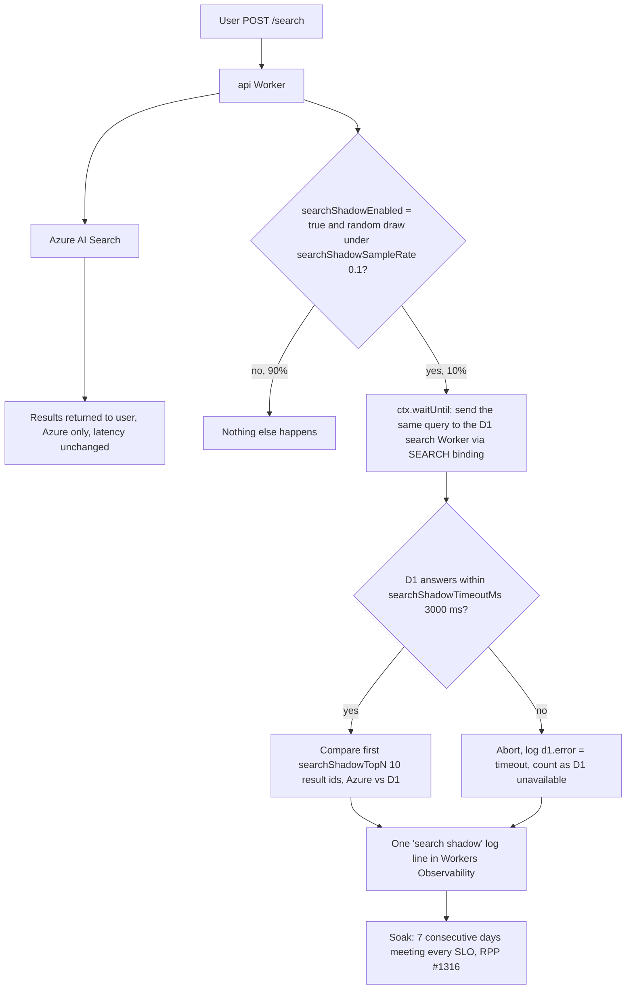

# D1 search shadow soak: SLOs and dashboard (SP-3.2)

[RPP #1323](https://github.com/cultpodcasts/RedditPodcastPoster/issues/1323), epic
[RPP #1312](https://github.com/cultpodcasts/RedditPodcastPoster/issues/1312). Running and passing the soak is gate SP-G3,
[RPP #1316](https://github.com/cultpodcasts/RedditPodcastPoster/issues/1316). This is the gate
before production `/search` moves from Azure AI Search to the D1 search Worker. The sync and
reconcile design is in RPP `docs/search-platform/sync-and-replication.md`. The sampler is
described in `workers/search/README.md` (`search shadow` log, SP-3.1, Api #228).

## What runs



| Setting | Production | Meaning |
|---------|------------|---------|
| `searchShadowEnabled` | `"true"` | On/off kill switch. `"false"` (or a rate of `"0"`) stops the sampler. |
| `searchShadowSampleRate` | `"0.1"` | 1 in 10 production searches is also sent to D1. Preview and local use `"0.01"` with the switch off. |
| `searchShadowTopN` | `"10"` | How many leading result ids from each engine are compared. |
| `searchShadowTimeoutMs` | `"3000"` | Abort the D1 call after 3 seconds. A timeout is logged as `d1.error = "timeout"` and counted as D1 unavailable (`slo.d1Unavailable = true`). Allowed range: 100–30000. |

These settings, including the kill switch, only take effect after Jon's manual production `api` deploy (`npm run deploy`). Merging to `main` alone does not deploy `api` (`docs/workers-builds-deploy.md`).

- The api Worker samples production `POST /search` requests when the switch is on (see the table). Preview and local stay off.
- Each sampled request sends the same rewritten body to the D1 search Worker over the `SEARCH`
  binding, on `ctx.waitUntil`. Azure is still the result users get, and their latency is unchanged.
- Each sample logs one line, `message = "search shadow"`, on the **`api`** Worker.
- A timed-out D1 call is still logged, with `d1.error = "timeout"`, no `d1.status` and `slo.d1Unavailable = true`.
  A hung D1 therefore counts against availability instead of disappearing from the log.
- **Kill switch:** set `searchShadowEnabled` to `"false"`, or the rate to `"0"`, then deploy production `api` as above.

## The soak

- **Length:** 7 consecutive days with every SLO met. Day 1 is the first full day after the production
  `api` deploy that carries this config (merging does not deploy `api`; see the kill switch above), and
  only once the prerequisites below hold.
- **Daily check:** evaluate each SLO once a day over the previous 24 hours, plus once over the
  whole 7 days at the end.
- **Any breach restarts the clock.** A breach is any SLO missed in a daily check, or a drift check
  above the limit. Fix the cause, then restart day 1.
- **Minimum sample:** a day with fewer than **200** `search shadow` samples, or fewer than **50**
  browse samples for the overlap SLO, has no verdict. It neither breaks nor extends the clock;
  the 7-day evaluation still has to pass.
- **Prerequisites:** these must be true before day 1, or day 1 is meaningless.
  - Production D1 is loaded, and a `D1SearchReconcile --full` dry run shows drift ≤ 0.5%.
  - The Functions push the index's changes to D1 (`d1SearchProductionEnabled` on in RPP
    `Infrastructure/functions.bicepparam`). Without the drip, D1 falls behind Azure during the soak,
    and counts and overlap degrade for reasons that have nothing to do with D1 search quality.

## SLOs

| # | SLO | Measured on | Pass |
|---|-----|-------------|------|
| 1 | Latency | `slo.bothOk = true` samples | D1 p95 `d1.latencyMs` ≤ Azure p95 `azure.latencyMs` **and** ≤ 300 ms |
| 2 | Availability | all samples | `slo.d1Unavailable = true` on ≤ 0.1% of samples |
| 3 | Result counts | samples with `slo.countWithin` present | `slo.countWithin = true` on ≥ 99% |
| 4 | Browse overlap | `queryKind = "browse"` samples with `slo.overlapOk` present (both 200, Azure had at least one hit) | `slo.overlapOk = true` on ≥ 95% |
| 5 | Drift | the week's full reconcile | drift ≤ 0.5% |

**Per-sample verdicts.** Workers Observability can only compare a field with a constant, never
two fields with each other. So the sampler computes every Azure-vs-D1 comparison itself
(`shadowSlo()` in `src/searchShadow.ts`) and logs it as a field:

| Field | Type | Meaning |
|-------|------|---------|
| `queryKind` | string | `browse`: no free text (empty or `*`), so a podcast or subject listing. `text`: a typed search |
| `azure.latencyMs`, `d1.latencyMs` | number | Time from the api Worker to each engine's full answer, in ms. D1 is measured over the service binding |
| `azure.status`, `d1.status` | number | HTTP status (absent if the engine never answered) |
| `azure.count`, `d1.count` | number | `@odata.count` |
| `azure.cacheStatus` | string | Azure only: `cf-cache-status` of the edge-cached Azure call (`HIT`, `MISS`, …). D1 is never edge-cached |
| `overlap.matched` | number | How many of Azure's top 10 ids are also in D1's top 10 |
| `overlap.sameOrder` | boolean | The two top-10 lists are identical, in order |
| `slo.d1Ok` | boolean | D1 answered 200 with no error |
| `slo.d1Unavailable` | boolean | D1 answered 429 or 5xx, or not at all (the binding threw, or the call hit `searchShadowTimeoutMs`: `d1.error = "timeout"`). A 4xx is a failure but not "unavailable" |
| `slo.bothOk` | boolean | Both engines answered 200. Only these samples carry the verdicts below |
| `slo.countDelta` | number | D1 count minus Azure count |
| `slo.countWithin` | boolean | \|countDelta\| ≤ max(2, 0.1% of the Azure count) |
| `slo.overlapNeeded` | number | min(9, number of Azure ids): 9 of the top 10 for a full page, all of a shorter list. **Absent when Azure returned no hits** |
| `slo.overlapOk` | boolean | `overlap.matched ≥ slo.overlapNeeded`. Absent when Azure returned no hits, so an empty page never passes SLO 4 vacuously (its count verdict still applies) |

Nested fields are flattened with dots. That is how Workers Observability already indexes the
api Worker's `searchLog` object lines (for example `query.filter` and `errors.searchStatus`).

## Dashboard: saved queries

Save each one in **Workers & Pages → Observability → Query Builder** (Save query). Use the names
below and set the timeframe to the last 24 hours for the daily check, or the last 7 days for the
final one; 7 days is Workers Observability's maximum range. The JSON is the same query in the
Observability API / MCP shape (`view`, `parameters`), so it can also be run with the Cloudflare
observability tools. Every query filters to the production api Worker:

```json
{ "key": "$metadata.service", "operation": "eq", "type": "string", "value": "api" },
{ "key": "message", "operation": "eq", "type": "string", "value": "search shadow" }
```

These two filters are referred to as **BASE** below.

### 1. `soak 1 latency p95`

```json
{
  "view": "calculations",
  "parameters": {
    "filters": [BASE, { "key": "slo.bothOk", "operation": "eq", "type": "boolean", "value": true }],
    "calculations": [
      { "key": "azure.latencyMs", "keyType": "number", "operator": "p95", "alias": "azure_p95" },
      { "key": "d1.latencyMs", "keyType": "number", "operator": "p95", "alias": "d1_p95" },
      { "operator": "count", "alias": "samples" }
    ]
  }
}
```

**Pass:** `d1_p95 ≤ azure_p95` and `d1_p95 ≤ 300`.

**Diagnostic:** add a group-by on `azure.cacheStatus`. Azure answers from the edge cache on a
`HIT`, and D1 never does, so a failure driven by `HIT` samples is a cache effect, not D1 being
slower. The SLO is still judged over all samples, as agreed. If it fails only because of cache
hits, take that to Jon rather than changing the rule silently. After the switch, D1 answers
would sit behind the same cache.

### 2. `soak 2 availability`

```json
{
  "view": "calculations",
  "parameters": {
    "filters": [BASE],
    "calculations": [{ "operator": "count", "alias": "samples" }],
    "groupBys": [{ "type": "boolean", "value": "slo.d1Unavailable" }]
  }
}
```

**Pass:** `true / (true + false) ≤ 0.001`.

**Diagnostic:** to see what failed, change the group-by to `d1.status`, or list events with
`slo.d1Ok = false`. On the search Worker (`$metadata.service = "search"`), D1 failures log
`$metadata.message = "search: D1 failure"`.

### 3. `soak 3 counts`

```json
{
  "view": "calculations",
  "parameters": {
    "filters": [BASE, { "key": "slo.countWithin", "operation": "exists", "type": "boolean" }],
    "calculations": [{ "operator": "count", "alias": "samples" }],
    "groupBys": [{ "type": "boolean", "value": "slo.countWithin" }]
  }
}
```

**Pass:** `true / (true + false) ≥ 0.99`.

**Diagnostic:** list events with `slo.countWithin = false`, showing `query`, `filter` and
`slo.countDelta`. A steady positive delta means D1 is matching more than Azure: a tokenizer
or filter difference. A negative delta on new episodes means sync lag.

### 4. `soak 4 browse overlap`

```json
{
  "view": "calculations",
  "parameters": {
    "filters": [
      BASE,
      { "key": "queryKind", "operation": "eq", "type": "string", "value": "browse" },
      { "key": "slo.overlapOk", "operation": "exists", "type": "boolean" }
    ],
    "calculations": [{ "operator": "count", "alias": "samples" }],
    "groupBys": [{ "type": "boolean", "value": "slo.overlapOk" }]
  }
}
```

**Pass:** `true / (true + false) ≥ 0.95`. The `exists` filter leaves out samples where Azure
returned no hits; those carry no overlap verdict.

**Diagnostic:** list events with `slo.overlapOk = false`, showing `filter` and `overlap.matched`.
Browse results are ordered by release date, so a miss is usually a missing or stale document
(sync) or a tie-break difference on the same release time.

Text queries are ranked differently by the two engines (BM25 versus Azure's scoring), so their
overlap is reported but is not an SLO. Run the same query with `queryKind = "text"` to watch it.

### 5. Drift (not in Workers Observability)

Drift comes from the Cosmos ↔ D1 reconcile, which runs in RPP, not in a Worker. Once a week,
Jon runs the console as a **dry run**:

```powershell
D1SearchReconcile --full
```

Read `drift x.xx%` from its summary line. **Pass:** ≤ 0.5%.

The Indexer's weekly timer (`D1SearchReconcile`, Sundays 04:30 UTC) logs the same line to
Application Insights, but only once `d1SearchProductionEnabled` is on. It stops at a 4.5-minute
budget, so a full pass may not finish there. Until a timer run is seen to complete, the console
run is the measurement. When it does run, this is the query:

```kusto
traces
| where timestamp > ago(7d)
| where message startswith "D1 search reconcile:"
| project timestamp, Outcome = tostring(customDimensions.Outcome), Drift = todouble(customDimensions.Drift),
          Missing = toint(customDimensions.Missing), Stale = toint(customDimensions.Stale),
          Orphans = toint(customDimensions.Orphans)
| order by timestamp desc
```

## Dashboard page

**`/docs/search-shadow-soak`** on the api Worker (linked from the `/docs` header) shows the soak
without the Query Builder: today (in progress) and the last 7 complete **UTC** days, plus a
7-day total, with each SLO's value against its target, pass / fail / no verdict, the sample
counts, and the consecutive green-day streak ([Api #304](https://github.com/cultpodcasts/Api/issues/304)).

- **Auth:** the same Auth0 docs session as `/docs` (`requireOpenApiAuth` on `/docs/*`): log in at
  `/docs/login`, and the token must carry the **`admin`** permission. No new auth path.
  `/docs`, `/docs/*` and `/openapi.json` share that one gate. A bearer header is tried first; if it does
  not verify (for example Swagger UI's stale saved token), the docs-session cookie is tried, and the
  `admin` check applies to whichever verified ([Api #310](https://github.com/cultpodcasts/Api/issues/310)).
  The page uses the same header as `/docs` (environment banner, version badge, Logout) plus an
  **API docs** link, without the token menu. On both pages the header is a normal row at the top
  of the page: it scrolls away with it and never floats over the content ([Api #312](https://github.com/cultpodcasts/Api/issues/312)).
- **Data:** every sample is also written as one **Workers Analytics Engine** data point
  (`SearchShadowAnalytics` binding; dataset `search_shadow` on `api`, `search_shadow_preview` on
  `api-preview`, `search_shadow_local` locally). The page reads it with the
  [Analytics Engine SQL API](https://developers.cloudflare.com/analytics/analytics-engine/sql-api/)
  (5 queries per page load: daily counts, daily / 7-day / hourly-today latency p50 and p95, and
  latency split by Azure edge-cache status; nothing is cached). Analytics Engine keeps 3 months, so the streak looks
  back 30 days. Samples are only recorded from the `api` deploy that carries this binding.
- **Why not the Workers Observability query API:** its telemetry query endpoint only accepts tokens with
  `Workers Observability: Write`, which cannot be scoped read-only, and its range is capped at 7 days.
  The Analytics Engine SQL API needs only `Account Analytics: Read`.
- **Verdicts:** the SLO rules above. A day passes only when SLOs 1–4 all pass; any fail is a fail and
  ends the streak; a day under the minimum sample (200, or 50 browse samples for overlap) has no
  verdict and neither breaks nor extends it. Latency is the weighted p95 over `slo.bothOk` samples.
  The 7-day row judges the 7 complete days together.
- **Layout** ([Api #312](https://github.com/cultpodcasts/Api/issues/312)): a status hero (one plain
  sentence, Day 1 and the earliest finish date, and a 7-step tracker of green days); **Today so far**
  as cards (samples against the 200 / 50 minimums, D1 p95 vs Azure, D1 errors, counts match, browse
  overlap), each with a provisional icon against its target; **Past 7 days** as a table with only the
  days that have data (empty days are collapsed to one line) plus the 7-day total; the charts; and a
  collapsed **How this works** with the SLO rules. Detail sits in icon tooltips.
- **Icons** (inline SVG): green check = pass, amber triangle = passes but close to the limit, red
  cross = over the limit, grey hourglass = not enough data yet. A day with too few samples is grey,
  not amber: amber is only a real margin. Today's icons apply the same thresholds to the values so
  far and never count towards the streak. **Earliest finish** assumes every day from Day 1 passes;
  with no run yet, today is Day 1 if it is on course for 200 samples, otherwise tomorrow.
- **Live:** while the page is open it refetches itself every 60 s (same URL, same docs session) and
  swaps the content in place, with a **Live · updated HH:MM:SS UTC** indicator and Pause / Resume. It
  does not poll while the tab is hidden and refreshes when the tab is shown again. If the session
  has expired (a redirect to login, 401 or 403) it stops and shows **Session expired · reload**.
- **Charts** (inline SVG, no library), oldest day first: speed by day (p50 and p95, 300 ms limit);
  speed today by hour (UTC); samples per day with the 200 / 50 minimums; D1 errors and timeouts
  (`d1.error = "timeout"`) with the 0.1% limit; counts match; browse overlap; and Azure latency on
  edge-cache `HIT` vs `MISS` searches next to D1's p95 on the same searches (other cache statuses are
  not charted). A chart with no values shows **No data yet** instead of empty axes.
- **Drift (SLO 5)** is not visible to the Worker (it comes from the RPP reconcile), so the page links
  to [§ 5. Drift](#5-drift-not-in-workers-observability) from **How this works**. It is not part of
  the page's streak.

### Red / amber / green

Every SLO cell, every day and the summary carry a RAG on top of the pass / fail / no-verdict verdict:

| RAG | Meaning |
|-----|---------|
| **Red** | Breach (the SLO's verdict is fail) |
| **Amber** | Passes but within the margin below, **or** no verdict because of too few samples (the page shows this case as a grey hourglass, not amber) |
| **Green** | Passes with margin |

Margins (named constants in `src/searchShadowSoak.ts`):

| SLO | Red (breach) | Amber when | Constant |
|-----|--------------|------------|----------|
| 1. Latency | D1 p95 > Azure p95 or > 300 ms | D1 p95 > 250 ms, or > 90% of Azure's p95 | `SOAK_RAG_LATENCY_MARGIN_MS = 50`, `SOAK_RAG_LATENCY_RATIO = 0.9` |
| 2. Availability | unavailable > 0.1% | unavailable > 0.05% | `SOAK_RAG_UNAVAILABLE_AMBER = 0.0005` |
| 3. Counts | agree < 99% | agree < 99.5% | `SOAK_RAG_COUNT_WITHIN_AMBER = 0.995` |
| 4. Browse overlap | ok < 95% | ok < 97% | `SOAK_RAG_OVERLAP_AMBER = 0.97` |

A day's RAG is the worst of its four. Today is shown as provisional. The **overall** RAG is red when
the latest judged complete day failed; otherwise it is the worst RAG of the days in the current run
(complete days with samples, back to the last fail), plus the 7-day row once the run reaches 7 days,
so failures before the clock restarted do not keep it red. With nothing judged yet it is amber.

| Data point field | Meaning |
|------------------|---------|
| `index1` | `search-shadow` |
| `blob1` … `blob4` | `queryKind`, `azure.cacheStatus`, `d1.status`, `d1.error` (no query text) |
| `double1`, `double2` | `azure.latencyMs`, `d1.latencyMs` |
| `double3`, `double4` | `slo.d1Unavailable`, `slo.bothOk` (1/0) |
| `double5`, `double6` | `slo.countWithin` present, `slo.countWithin` |
| `double7`, `double8` | `slo.overlapOk` present, `slo.overlapOk` |
| `double9`, `double10` | browse sample (1/0), `overlap.matched` |

### Setup (Jon)

1. **Create the token.** Cloudflare dashboard → My Profile → API Tokens → Create Token → Custom token
   (an account API token under Manage Account → API Tokens works too):
   - Permissions: **Account → Account Analytics → Read**. Nothing else.
   - Account resources: **Include → the cultpodcasts account** (`bae3f835f19899c6eee1ec48f2d658cf`) only.
   - No zone resources. Leave Client IP Address Filtering empty (the Worker calls from Cloudflare's network). An expiry is optional.
2. **Set the secret** (it is prompted for, never on the command line; from the Api repo root):

   ```powershell
   # production: top-level Worker `api` (not --env production)
   npx wrangler secret put cfAnalyticsReadToken --env=
   # preview: `api-preview`
   npx wrangler secret put cfAnalyticsReadToken --env preview
   ```

   Or add `cfAnalyticsReadToken=` to `scripts/local-secrets.*.env` and run `set-secrets-*.ps1`.
   Locally, put it in `.dev.vars`.
3. **No other setup.** `cloudflareAccountId` and `searchShadowAnalyticsDataset` are plain `vars` in
   `wrangler.jsonc`, and Analytics Engine creates each dataset on its first write. Both take effect with
   the next manual `api` / `api-preview` deploy.

Until the token is set the page answers 503 "Not configured" and names the missing setting.

## Evaluating a day

1. Run queries 1–4 over the last 24 hours, and record the numbers on RPP #1323 (one comment a day).
2. If any query fails and has at least the minimum sample, that is a breach. Note it, fix it, and
   restart at day 1.
3. On day 7, run queries 1–4 over the last 7 days, and run the drift check. If all pass, the soak
   is over, and the production switch (Api #231/#232) can be scheduled with Jon.

## Known limits

- The search Worker's own lines (`search: d1 read`, `search: admin write`) are logged as
  `console.log(name, object)`. Workers Observability indexes only the name of such a line
  (`$metadata.message`), not the object's fields, so per-region D1 timings (`servedByRegion`,
  `sqlDurationMs`) cannot be charted today. None of the SLOs above need them.
- Latency is measured from the api Worker, so both engines include their network path. D1's
  path includes the service binding.
