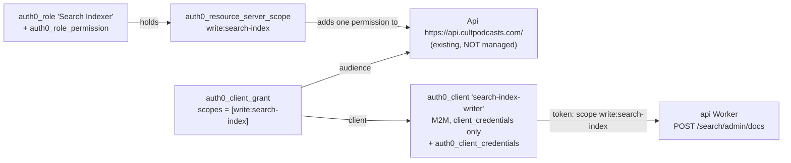

# Terraform: Auth0 search-index write access

[Api#284](https://github.com/cultpodcasts/Api/issues/284). `POST /search/admin/docs`
([Api#281](https://github.com/cultpodcasts/Api/pull/281), `src/searchAdminDocs.ts`) only accepts an
Auth0 **M2M** (client_credentials) token carrying **`write:search-index`** on the Api. Terraform
creates everything that puts that permission into the writer's token. Nothing is set up in the
dashboard, apart from the one-time bootstrap below (the credentials Terraform itself uses).

Jon, 17 Nov 2026: *"You should have auth0 in terraform"*, *"in tf"*, *"new role + permission"*.

| Path | What |
|------|------|
| [`../modules/auth0-search-index-writer/`](../modules/auth0-search-index-writer) | One tenant: permission, role, M2M app, its credentials, its client grant. All `prevent_destroy`. |
| [`production/`](./production) | **Prod tenant** (login domain `auth.cultpodcasts.com`). HCP workspace `cultpodcasts-auth0`. Environment `cloudflare-production`. |
| [`preview/`](./preview) | **Staging tenant** (login domain `auth-staging.cultpodcasts.com`). HCP workspace `cultpodcasts-auth0-preview`. Environment `cloudflare-preview`. |

Staging and production are **different Auth0 tenants**, so each has its own root, workspace and
management credentials, as the search stack has one per Cloudflare stack.

## What Terraform creates, per tenant



| Resource | Why |
|----------|-----|
| `auth0_resource_server_scope.write_search_index` | The permission, added to the **existing** Api. One scope only: the Api's other permissions and settings are untouched. |
| `auth0_role.search_indexer` + `auth0_role_permission` | **Search Indexer** role holding the permission (Jon: "new role + permission"). Assigned to nobody: Auth0 puts permissions into M2M tokens through the client grant, not roles, and the route refuses non-M2M tokens. |
| `auth0_client.search_index_writer` | Dedicated M2M app (`non_interactive`, `client_credentials` grant only), separate from the shared Azure Functions app (`Auth0-ClientId`), so it can be rotated or revoked alone. |
| `auth0_client_credentials.search_index_writer` | `client_secret_post`. Auth0 generates the secret; Terraform keeps it only in HCP state (sensitive). |
| `auth0_client_grant.search_index_writer` | The writer's tokens for the Api carry `write:search-index` and nothing else. |

No other permission opens this endpoint (Jon, 17 Nov 2026), and none is referenced here.

### The Api is referenced, not owned

The Api (resource server) is passed in as `api_identifier` (default `https://api.cultpodcasts.com/`
in both roots; the staging website requests that same audience from the staging tenant, see
website `environment.staging.ts` and `app.config.ts`). It is not imported: owning it would let a plan rewrite or delete the API every
login and token in the tenant depends on, and `auth0_resource_server` would also have to manage
its full settings. It is not read with a data source either: that would copy the API's settings
into state for no gain. If the identifier is wrong, the first apply fails creating the scope
(`404`), and nothing is half-made. Override per root with `TF_VAR_api_identifier`.

## Pipeline: `.github/workflows/auth0-stack.yml`

| Event | Staging tenant (preview root) | Prod tenant (production root) |
|-------|-------------------------------|-------------------------------|
| PR from this repo (not forks) | plan → guard → sticky plan comment → **apply**, in `cloudflare-preview` | — |
| Push to `main` | — | after **Jon's approval** in `cloudflare-production`: plan → guard → apply |
| Manual run on `main` | — | as push (rebuild from scratch, or re-apply) |

Triggers: this folder, the module, the shared scripts (`plan-guard.mjs`,
`hcp-workspace-check.mjs`, `sticky-plan-comment.mjs`) and the workflow. The search stack
workflow ignores the Auth0 folders, so an Auth0-only change does not redeploy search.

- **No production plan on PRs.** The only prod-tenant credentials are the Terraform management
  app's, which can write, and they live in `cloudflare-production`, which only `main` may use. The
  PR shows the staging plan of the same module; the production plan is in the approved job's
  summary, and the guard runs before its apply. (A read-only plan app is a possible later
  addition; it would still need `read:client_keys`, which reads the writer's secret.)
- **No Api code deploy depends on this.** The route is already live and answers 403 until the
  grant exists. The writer (RPP SP-2.1) is configured from this stack's outputs after an apply.
- **Readiness fails clearly**: a missing `TF_TOKEN_APP_TERRAFORM_IO`, any `TF_AUTH0_*` visible as a
  repo/org secret, a missing `cloudflare-preview`, or a `cloudflare-production` without required
  reviewers. Each apply job first checks its three `TF_AUTH0_*` environment secrets, names the
  missing ones, and rejects a domain that is not `<tenant>.<region>.auth0.com`. The HCP check fails
  if the workspace is missing or not Local.

### Deletion protection

Every resource is `prevent_destroy`, and the plan guard (`scripts/plan-guard.mjs --stack=auth0`)
refuses any delete or replace of `auth0_*` permission, role, client, credentials or grant
resources (prevent_destroy cannot help once a block is deleted). Replacing the client would issue
a new client id and secret and break the writer. Creates are allowed: that is the first apply and
a rebuild from scratch. There is no destroy path in the workflow.

A routine retire is a reviewed PR with a `removed { lifecycle { destroy = false } }` block (the
resource leaves state; nothing in Auth0 changes), removed again after use, as #275 did for the
search stack. Destroying a protected resource is an exceptional, reviewed operation outside CI,
as for the search stack (see [`../README.md`](../README.md), Deletion protection).

### Drift: a client or grant that left state

The guard prints a `::warning` for every create of `auth0_client` or `auth0_client_grant`. On the
first apply or a rebuild that is expected. On an established tenant it means the resource left
this workspace's state (a state restore, a wrong workspace). If the client left, the apply makes
a **second** `search-index-writer` app and grant. Nothing breaks: the original app, its grant and
the writer's credentials keep working, and the new app is unused. If only the grant left, its
create fails loudly at apply (Auth0 allows one grant per client and API) and nothing changes. To clean up, a reviewed PR either
adopts the original with a one-off `import` block (removed after use, as in #275) before the
apply, or, if the duplicate was already made, forgets it with a `removed` block and retires it as
above.

### Rebuild from scratch

Tearing the resources down (dashboard) and re-running CI recreates them: preview on the next PR
run, production with a manual run on `main` (approval). The rebuilt client has a **new client id
and secret**, so the writer must be re-configured from the new outputs.

## Where the writer's credentials go

- **Client id** (not a secret): output `client_id`.
- **Client secret**: only in HCP state, as the sensitive output `client_secret`. CI never runs
  `terraform output`, and `terraform show` masks it, so it is never printed or committed.
- **Delivery to the caller is a follow-up**, not this PR. The caller is the RPP indexer (SP-2.1,
  [RedditPodcastPoster#1321](https://github.com/cultpodcasts/RedditPodcastPoster/issues/1321)),
  which runs in the Azure Functions (bicep). Following the existing `Auth0-ClientId` /
  `Auth0-ClientSecret` pattern, the values belong in Key Vault `cultpodcasts-deployment`, read by
  `Infrastructure/functions.bicepparam` with `az.getSecret` into the Function app settings.
  Azure stays on bicep: Terraform here creates no Azure resources. How the value gets from HCP
  state into Key Vault without a hand copy is open (see the PR's decisions).

## What Jon creates (once): the Auth0 bootstrap

Agents never create these, never call the Management API and never see the values. Do steps 1–2
**once in each tenant**: staging values go in `cloudflare-preview`, prod values in
`cloudflare-production`.

1. **Terraform management app** (Auth0 dashboard of the tenant → Applications → Applications →
   Create Application): name `terraform-cultpodcasts-prod` (or `terraform-cultpodcasts-staging`),
   type **Machine to Machine**. Authorise it for **Auth0 Management API** with only:

   | Scopes | For |
   |--------|-----|
   | `read:resource_servers`, `update:resource_servers` | the `write:search-index` scope on the Api |
   | `read:roles`, `create:roles`, `update:roles`, `delete:roles` | the Search Indexer role and its permission |
   | `read:clients`, `create:clients`, `update:clients`, `delete:clients`, `read:client_keys` | the writer app and its secret |
   | `read:client_grants`, `create:client_grants`, `update:client_grants`, `delete:client_grants` | the writer's grant |

   Nothing else (no users, no tenant settings). The `delete:*` scopes are only used by a reviewed
   `removed`/retire change; CI's guard never plans a delete.
2. **GitHub environment secrets** (Api repo → Settings → Environments), from the app's Settings tab:
   - `TF_AUTH0_DOMAIN`: the **canonical** tenant domain from Tenant Settings
     (`<tenant>.<region>.auth0.com`), **not** `auth.cultpodcasts.com` / `auth-staging.cultpodcasts.com`
     (the Management API is not served on custom domains).
   - `TF_AUTH0_CLIENT_ID`, `TF_AUTH0_CLIENT_SECRET`.

   Prod tenant values on `cloudflare-production`, staging tenant values on `cloudflare-preview`.
   **Not** as repo secrets: readiness fails if it can see any of them outside an environment.
3. **HCP Terraform** (org `cultpodcasts`): workspaces **`cultpodcasts-auth0`** (prod) and
   **`cultpodcasts-auth0-preview`** (staging), **CLI-driven**, **Execution Mode: Local**, no
   workspace variables. `TF_TOKEN_APP_TERRAFORM_IO` must be able to write both.
4. If the staging tenant's Api identifier is not `https://api.cultpodcasts.com/`, change the
   `api_identifier` default in `preview/variables.tf`.

`TF_TOKEN_APP_TERRAFORM_IO` and both environments already exist for the search stack.

## Local checks (no credentials)

```sh
terraform fmt -check -recursive infra/terraform
for d in infra/terraform/auth0/production infra/terraform/auth0/preview; do
  terraform -chdir=$d init -backend=false && terraform -chdir=$d validate
done
npx vitest run tests/auth0-stack-terraform.spec.ts
```
