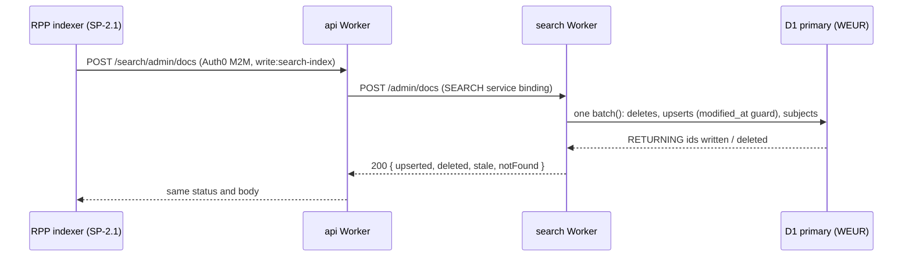
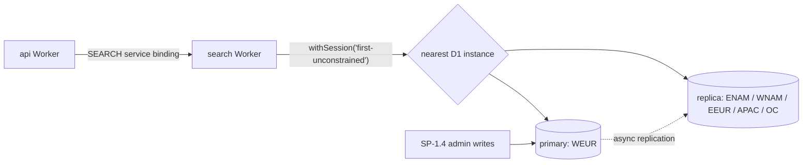
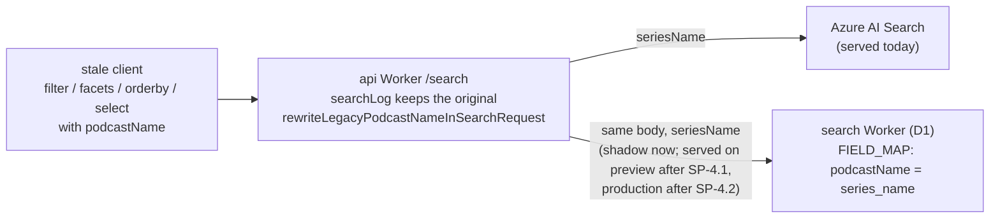

# search

Search platform Worker (epic [RedditPodcastPoster#1312](https://github.com/cultpodcasts/RedditPodcastPoster/issues/1312),
Gate G1). It owns the **dedicated search D1 databases** `cultpodcasts-search` and `cultpodcasts-search-preview` (SP-1.1,
[Api#219](https://github.com/cultpodcasts/Api/issues/219)) and will serve the D1 FTS5 engine
that replaces Azure AI Search, running side by side with Azure until cutover (G4).

Design docs: RedditPodcastPoster `docs/search-platform/` (start at `README.md`).

## Shape

| Worker | Config | D1 binding | Database |
|--------|--------|-----------|----------|
| `search` (production) | `wrangler.search.jsonc` top level | `SEARCH_DB` | `cultpodcasts-search` |
| `search-preview` | `wrangler.search.jsonc` `--env preview` | `SEARCH_DB` | `cultpodcasts-search-preview` |
| local | `--env local` | `SEARCH_DB` | Miniflare only |

- **Dedicated:** never the api Worker's `apiDB` (`cultpodcasts-api`), and the api Worker does
  not bind this database. It reaches this Worker over a **service binding** (SP-1.3), because
  zone Bot Fight Mode challenges server POSTs to public hostnames.
- **Service-binding only:** `workers_dev: false`, `preview_urls: false`, no routes.
- **Preview and production have separate databases** (Jon, 16 Nov 2026), so preview code and
  preview sync never touch the production index. The G2 sync path must therefore feed both.
- Region: primary in **WEUR** (near Azure Functions / Cosmos), read replicas everywhere else
  through the Sessions API (SP-1.2, below).
- Not part of Api Workers Builds (one Builds project = one Worker name).

## Schema

`migrations/0001_search_schema.sql`:

- `search_docs`: one row per playable (Episode, TvShowEpisode, Film, NewsReport), mirroring
  RPP `EpisodeSearchRecord`, plus **full descriptions**, **guests**, film
  **`alternative_titles`**, identity ids (`imdb_id`, `tmdb_id`, `tvdb_id`, series variants)
  and `modified_at` for the SP-1.4 stale-replay guard.
- `doc_subjects`: subject filter/facet rows (cascade on delete).
- `search_fts`: external-content FTS5, `tokenize='porter unicode61'`, kept in step by
  insert/update/delete triggers. Column order is a contract (SP-1.8 weights against it):
  `title, alternative_titles, series_name, subjects_text, description, guests,
  publisher_search_terms, episode_search_terms`. Changing it needs a shadow rebuild (SP-2.3).
- `search_meta`: `schema_version`. `GET /health` returns 503 until it matches
  `SEARCH_SCHEMA_VERSION` in `src/health.ts`.

### Write contract (FTS triggers)

`search_fts` is external-content: the triggers are the only thing keeping it in step with
`search_docs`.

- **Upsert only with `INSERT … ON CONFLICT(id) DO UPDATE SET …`.** It keeps the rowid and fires
  `search_docs_au`.
- **Never `INSERT OR REPLACE` / `REPLACE INTO` on `search_docs`.** REPLACE deletes the old row
  without firing `search_docs_ad` (unless `PRAGMA recursive_triggers` is on, which every write
  path would have to remember), so the old terms stay in `search_fts`: stale hits and a failing
  integrity check, with no error at write time.
- `search_docs_au` fires only when an FTS column changes (`AFTER UPDATE OF` the eight FTS
  columns), so updating `modified_at`, `image` or ids does not rewrite the index.
- After bulk work, check with the content-aware integrity check:
  `INSERT INTO search_fts(search_fts, rank) VALUES ('integrity-check', 1);`

`tests/search-worker.spec.ts` pins all of this.

### Migrations and schema version

- One migration per schema version: `0001_…` is version 1, `0002_…` is version 2, and so on.
- Every migration after `0001` ends with
  `UPDATE search_meta SET value = '<n>' WHERE key = 'schema_version';`
  and bumps `SEARCH_SCHEMA_VERSION` in `src/health.ts` in the same PR.
- The spec applies every file in `migrations/` in name order and checks the final
  `schema_version` equals `SEARCH_SCHEMA_VERSION`, so a migration that forgets either fails CI.

## Provisioning (Terraform, SP-1.10)

Both databases are provisioned by **Terraform**, not by hand: SP-1.10
([Api#270](https://github.com/cultpodcasts/Api/issues/270)) adds the `cloudflare` provider
with a `cloudflare_d1_database` for `cultpodcasts-search` and `cultpodcasts-search-preview`
(both primary in `weur`), and a CI workflow that runs `wrangler d1 migrations apply --remote`
for each database after `terraform apply` (preview first, then production), from
`workers/search/migrations`. Terraform created both databases on 16 Nov 2026; their ids are in
`wrangler.search.jsonc`, written by `infra/terraform/scripts/sync-wrangler-ids.mjs` from the
Terraform outputs. The local binding keeps its `local-cultpodcasts-search` id, which the sync
script never touches.

Deletion protection is part of SP-1.10: `prevent_destroy` on both databases, a CI plan guard
that fails on any destroy or replace, apply behind a GitHub environment approval, and D1 Time
Travel documented for point-in-time restore. Azure stays on bicep.

Never run `wrangler d1 create` / `d1 delete` for these by hand. Schema changes reach the remote
databases only through the Terraform workflow's migration step (after Jon approves the
`cloudflare-production` environment), not `wrangler d1 migrations apply --remote` from a laptop.

## Local

```sh
npm run search:migrate:local
npm run search:dev            # http://127.0.0.1:8789/health
```

## Routes

| Route | Purpose |
|-------|---------|
| `GET /health` | 200 when D1 answers and the schema version matches; 503 otherwise (retryable) |
| `POST /indexes/{index}/docs/search` | Azure AI Search docs/search over D1 FTS5 (SP-1.9) |
| `POST /admin/docs` | Index write path: upserts and deletes in one transaction (SP-1.4, below) |
| `GET /admin/docs/inventory` | `{ id, modifiedAt }` pages for the weekly reconcile (SP-2.2, below) |
| `GET /admin/rebuild`, `POST /admin/rebuild/{action}` | Rebuild the whole index into shadow tables and swap it in (SP-2.3, below) |

`GET /health` also returns `servedByRegion` / `servedByPrimary` (SP-1.2).

## Write path: `POST /admin/docs` (SP-1.4)

[Api#222](https://github.com/cultpodcasts/Api/issues/222). `src/admin-docs.ts`.



- **Body:** `{ "upserts": [doc…], "deletes": ["id"…] }`, at most 100 upserts and 1000 deletes, each
  id at most once. A doc is the Azure document (`EpisodeSearchRecord` keys, as docs/search
  returns them) plus `guests`, `publisherSearchTerms`, `episodeSearchTerms` and **`modifiedAt`**
  (epoch ms of the source change). `contentKind` absent or null means `Episode`. `release` is any
  ISO-8601 date-time with a zone and is stored as UTC `yyyy-MM-ddTHH:mm:ssZ`. Unknown fields are a
  400 (a typo such as `guest` would otherwise silently index nothing); the three
  `[FieldBuilderIgnore]` legacy fields (`podcastName`, `episodeTitle`, `episodeDescription`) are
  accepted and dropped.
- **One transaction:** the whole request is one D1 `batch()` on the primary (`writeDb`, never a
  read session), so a failure writes nothing and returns the fixed retryable **503**. A bad body is
  **400** before anything is written.
- **Stale-replay guard:** the upsert is
  `INSERT … ON CONFLICT(id) DO UPDATE … WHERE excluded.modified_at >= search_docs.modified_at`. An
  older `modifiedAt` is dropped and listed in `stale`; an equal one applies (a retry). Subjects are
  rewritten only for upserts the guard let through.
- **Every applied upsert rewrites its FTS row.** `search_docs_au` is `AFTER UPDATE OF` the FTS
  columns, which fires when the SET list names a column, not when its value changes, and the upsert
  sets all of them. So re-pushing an unchanged document still costs an FTS delete and insert (rows
  written). Push only new or changed documents; the weekly reconcile (SP-2.2) should send only
  missing or stale ones, not the whole corpus. (Targeted `UPDATE`s of non-FTS columns, as in the
  write contract above, still leave the index alone.)
- **Deletes** are by id; `doc_subjects` cascades and `search_docs_ad` removes the FTS row. Ids the
  index does not have are listed in `notFound`, not an error. A delete has no tombstone: a stale
  upsert replayed after a delete re-inserts the document until the weekly reconcile (SP-2.2)
  removes the orphan.
- **Batching:** documents bind as one JSON parameter per chunk (D1 allows 100 bound parameters per
  statement, and a document has 29 columns). Chunks stay under 1 MB of JSON (D1 caps a bound value
  at 2 MB), so a request is `1 + 3 × chunks` statements.
- **Auth:** this Worker has no public ingress, so only service-binding holders can call it. The api
  Worker's `POST /search/admin/docs` (`src/searchAdminDocs.ts`) is the door: it requires an Auth0
  **M2M** (client_credentials) token carrying the dedicated **`write:search-index`** permission
  (`src/searchIndexWritePermission.ts`, read from `scope` or `permissions`), and forwards the body
  and the answer unchanged. That permission is the only one that opens the route; no other
  permission is checked. A missing or invalid token is 401; a token without the permission, or a
  person's (non-client_credentials) token even with it, is 403. No new secret on either Worker:
  the api Worker already verifies Auth0 tokens with `auth0Issuer` / `auth0Audience`.
- **Log:** each applied request logs `search: admin write` with the four counts.

## Inventory: `GET /admin/docs/inventory` (SP-2.2)

[RPP #1322](https://github.com/cultpodcasts/RedditPodcastPoster/issues/1322). `src/admin-inventory.ts`.
The RPP weekly reconcile pages through it, compares it with Cosmos, and sends only missing or stale
upserts and orphan deletes through `POST /admin/docs`.

- **Query:** `after` (exclusive id; omit for the first page) and `limit` (1 to 10000, default
  5000). A bad value is **400** and names the parameter.
- **Answer:** `200 { "items": [{ "id", "modifiedAt" }…], "next": "id" | null }`, ordered by `id`.
  Pass `next` back as `after` until it is null. Keyset paging on the UNIQUE `id` index: each page
  reads `limit + 1` rows (the extra row says whether there's a next page), with no COUNT and no
  OFFSET. About 90k documents is about 18 requests a week.
- **Primary, not a replica:** the reconcile writes right after it reads, so the inventory is read
  on the primary (`writeDb`). A replica could be behind the reconcile's own last write.
- **Auth:** the api Worker's `GET /search/admin/docs/inventory` uses the same gate as the write
  path (Auth0 M2M `write:search-index`), because only the writer reconciles. It forwards `after`
  and `limit` only. D1 failure is **503** (retryable).

### Auth0 setup for the write path

Terraform, not the dashboard ([Api#284](https://github.com/cultpodcasts/Api/issues/284)):
[`infra/terraform/auth0/`](../../infra/terraform/auth0/README.md) creates, in the staging and the
prod tenant, the `write:search-index` permission on the Api (`https://api.cultpodcasts.com/`), the
**Search Indexer** role holding it (assigned to nobody), a dedicated `search-index-writer` M2M app,
and its client grant with only `write:search-index`. The grant is what puts the permission in the
writer's client_credentials token; the route never reads roles. The one-time bootstrap (the
Terraform management app per tenant, its environment secrets, two HCP workspaces) is in that README.

**Check** after an apply: request a token with `client_credentials` for the Api audience using the
writer's client id (output `client_id`) and secret, and confirm `scope` contains
`write:search-index` and `gty` is `client_credentials`. A token without it gets 403; the api
Worker's `search_admin.forbidden` log line says `reason=missing_permission` (no grant) or
`reason=not_m2m` (not a client_credentials token), with the token's `azp`.

## Rebuild: `/admin/rebuild` (SP-2.3)

[Api#226](https://github.com/cultpodcasts/Api/issues/226). `src/admin-rebuild.ts`, `src/index-generations.ts`.

For the rare case a patch can't fix (drift beyond the reconcile's threshold, a corrupt index). It runs
from the RPP console (`D1SearchReconcile --rebuild`, Jon's call, 21 Nov 2026), which reads Cosmos with
the reconcile's own rules. A schema or tokenizer change stays a migration (an external-content FTS
table can be rebuilt from `search_docs` in SQL), so this never runs on a schedule.

```mermaid
sequenceDiagram
  participant C as RPP console
  participant A as api Worker /search/admin/rebuild
  participant S as search Worker
  C->>A: start
  A->>S: create search_docs_new, doc_subjects_new, search_fts_new + triggers
  loop 100 documents a request
    C->>A: docs { rebuildId, upserts }
  end
  Note over S: meanwhile POST /admin/docs writes live and shadow in one batch
  C->>A: swap { rebuildId, expectedTotal, expectedKinds, tolerance, maxShrink }
  A->>S: verify counts, FTS rows, FTS structure; then one batch: live -> _old, _new -> live
  C->>A: check { rebuildId, sampleQueries }
  alt checks pass (and the console's reconcile dry run is clean)
    C->>A: finish (drop _old)
  else
    C->>A: swap-back, then abort (drop the rejected tables)
  end
```

- **One transaction.** The swap is a single `db.batch()`: drop the live triggers and secondary
  indexes, rename live to `_old`, rename `_new` to live, recreate the indexes and triggers from the
  live schema's own SQL (`sqlite_master`). Readers see the old index or the new one, never a mix; a
  failure anywhere rolls the whole batch back (503, nothing changed).
- **Why recreate triggers and indexes.** A rename rewrites foreign keys and trigger table names, but
  not an FTS5 `content=` option or the FTS "special column" a trigger names
  (`INSERT INTO search_fts (search_fts, …) VALUES ('delete', …)`): kept, the delete and update
  triggers would fail after a swap. So the shadow FTS table is created with `content='search_docs'`
  (its content table's name after the swap) and the swap rebuilds every trigger and index under its
  migration name. Indexes are built in the swap, not during the load, which also keeps the load fast.
- **Verification gate (409 `VerificationFailed`, nothing changed).** The shadow's total and per-kind
  counts must be within `tolerance` of what the console loaded (`tolerance` covers pushes during the
  load); the FTS index must hold one row per document and pass a structure `integrity-check`; and the
  shadow may not be smaller than the live index by more than `maxShrink` (default 5%; the RPP console
  sends its own `d1Search:Rebuild:MaxShrink`, because the live index may be the bloated one being
  replaced, and relies on the Cosmos counts as the real size gate).
- **Pushes during a load** go to both generations in the same batch (`POST /admin/docs` reads the
  `rebuild` row in `search_meta`), with the same `modifiedAt` guard, so the swap loses none. A delete
  that races the console's Cosmos read can resurrect a document in the shadow; the console's
  post-swap reconcile catches it.
- **Pushes after the swap**, until `finish` or `swap-back`, also go to the parked `_old` generation:
  the swap gives it its own `_old` triggers, so its FTS stays in step. A swap-back therefore
  restores an index that missed nothing written during the console's checks (including its
  post-swap reconcile). `finish` drops the parked tables and their triggers with them.
- **Unreadable state fails safe.** A `rebuild` row in `search_meta` that is not a valid state makes
  `POST /admin/docs` answer 503 `RebuildStateUnreadable` and every rebuild route 409
  `RebuildStateUnreadable`, instead of treating it as "no rebuild" (which would silently stop the
  dual-write). Fix or delete the row (and any `_new` / `_old` tables) by hand.
- **States** (`search_meta` key `rebuild`): `loading` → `swapped` → finished (row removed), or
  `swapped` → `swappedBack` → aborted. `start` refuses (409) while any rebuild is recorded or a
  `_new` / `_old` table is left over; `abort` refuses while the new index is live.
- **`check`** (after the swap) runs the content-aware `integrity-check` against the new live tables,
  returns counts, and counts hits for up to 10 sample queries (each matched as a phrase).
- **Verified** on local workerd D1 (`wrangler dev --env local`): two full cycles (finish, then
  swap-back + abort), with updates and deletes reaching the FTS index after each swap. A preview run
  is the remaining check before production.
- **Preview-proof step: index build time.** The swap batch recreates five secondary indexes over the
  whole new generation (`idx_search_docs_*` and `idx_doc_subjects_subject`, ~92k documents in
  production). Each `CREATE INDEX` is its own statement and must stay inside D1's 30 s
  per-statement limit. Building them during the load instead would leave them with `_new` names
  (SQLite cannot rename an index), so they stay in the swap. A timeout is safe (503, the batch
  rolls back, state stays `loading`), but run one full rebuild on a production-sized preview index
  and note the swap's duration (`search: rebuild` log) before the first production rebuild.

## Read replication and the Sessions API (SP-1.2)

[Api#220](https://github.com/cultpodcasts/Api/issues/220). Both databases have
`read_replication = { mode = "auto" }` (Terraform module `infra/terraform/modules/search-stack`,
applied since SP-1.10), so Cloudflare keeps a read replica in each D1 region (ENAM, WNAM, WEUR,
EEUR, APAC, OC). D1 only routes a query to a replica when it runs through a **session**, so:

- **Every read goes through `readSession(env)`** (`src/d1-session.ts`):
  `env.SEARCH_DB.withSession("first-unconstrained")`, one session per request. The first query
  may go to the nearest replica; the rest of the request (the page/count/facet batch and then the
  page's subject lookup) sees a database at least as new as the first query (never older, as two
  independent reads on different replicas could). A test fails if any Worker source calls `SEARCH_DB.prepare` / `batch` directly.
- **No bookmarks from callers.** Search readers never write, and a result a few seconds behind the
  primary is fine for search (Azure indexing is not instant either).
- **Writes stay on the primary.** D1 always sends writes to the primary; the SP-1.4 admin route
  uses `writeDb(env)` (the database itself, no session), never `readSession`.
- **`GET /health` uses the same path**, so it reports the schema version search actually sees: right
  after a migration a replica can briefly answer with the old version (503). It returns
  `servedByRegion` / `servedByPrimary` in its body and does not write the log line below.



### `served_by_region` log (soak)

Each successful `docs/search` request logs one line, `search: d1 read`, from the D1 result `meta`:

| Field | Meaning |
|-------|---------|
| `route` | `docs/search` |
| `environment` | `production` / `preview` / `local` |
| `servedByRegion` | Distinct `served_by_region` values in query order (`"ENAM"`, or `"ENAM,WEUR"` if a request spanned two) |
| `servedByPrimary` | `true` only when every query ran on the primary |
| `servedByColo` | Distinct `served_by_colo` values |
| `sqlDurationMs` | Sum of `timings.sql_duration_ms` (execution only, no network) |
| `queries` | D1 results read |

Fields D1 does not return (local Miniflare) are `null`. Failed requests log only the existing
`search: D1 failure` line. Query in Workers Observability with `message = "search: d1 read"`,
grouped by `servedByRegion`; the SP-3.2 soak dashboard charts it. The line is unsampled; if volume
ever matters, set `observability.head_sampling_rate` in `wrangler.search.jsonc`. Whether to keep it
after cutover is for SP-3.2 to decide.

### `search shadow` log (SP-3.1)

The api Worker can also sample a fraction of `POST /search` traffic and send the same rewritten
body to this Worker over the `SEARCH` binding, on `ctx.waitUntil` so user latency is unchanged.
Azure remains the served result. Each sampled request logs one line, `search shadow`, with Azure
vs D1 latency, `@odata.count`, top-N id overlap, and a compact error (code/message, not the raw
body). The query text is the same inbound string searchLog already records; `requestId` is the
`cf-ray` so the two lines can be joined.

Kill switch and rate are non-secret wrangler vars on the api Worker (`wrangler.jsonc`, top-level
`api`, `env.preview`, and `env.local`):

| Var | Meaning | Default |
|-----|---------|---------|
| `searchShadowEnabled` | `"true"` / `"false"` kill switch | production `"true"` (SP-3.2 soak); preview and local `"false"` |
| `searchShadowSampleRate` | Fraction of `/search` requests to sample (0–1) | production `"0.1"`; preview and local `"0.01"` |
| `searchShadowTopN` | Leading hit ids compared | `"10"` |
| `searchShadowTimeoutMs` | Abort the shadow D1 call after this many ms (100–30000); logged as `d1.error = "timeout"`, `slo.d1Unavailable = true` | `"3000"` |

Query in Workers Observability with `message = "search shadow"`. Set `searchShadowEnabled` to
`"false"` or the rate to `"0"` to stop sampling without a code change.

Each line also carries the SP-3.2 soak verdicts (`queryKind`, `azure.cacheStatus`, and `slo.*`:
`d1Ok`, `d1Unavailable`, `bothOk`, `countDelta`, `countWithin`, `overlapNeeded`, `overlapOk`),
because Workers Observability can only compare a field with a constant. The SLOs, the saved
queries and how to judge a soak day are in [`docs/search-shadow-soak.md`](../../docs/search-shadow-soak.md).

## Query engine (SP-1.9)

Moved from the `search-demo/` prototype ([Api#269](https://github.com/cultpodcasts/Api/issues/269)),
read-only, against the SP-1.1 schema:

| File | Role |
|------|------|
| `src/query.ts` | Azure "simple" syntax → FTS5 `MATCH`, mirroring `en.lucene` (stopwords, hyphen split, possessives). Every atom is quoted, so user text cannot inject FTS5 syntax. |
| `src/odata.ts` | The OData subset the website sends: `eq` / `ne` / `null`, `search.in`, `subjects/any`, `and` / `or` / parentheses; facet specs. `lang` NULL means English. |
| `src/azure-response.ts` | The live Azure document (25 retrievable keys, Azure order) and envelope (`@odata.context: null`). |
| `src/docs-search.ts` | The route: body parsing, SQL, facets, `select`, errors. |

Contract (same as `search-demo`): `search`, `searchMode` (`any` default, `all`), `filter`,
`orderby` (`release desc` / `release asc`; relevance when searching, newest first when browsing),
`top` (default 50, max 1000) / `skip` / `count`, `facets` (`subjects`, `contentKind`, `lang`,
`seriesName`; `count:n` up to 1000) and `select`. The `{index}` segment and `api-version` are
accepted and ignored (one database per Worker), and so is `api-key`: the Worker is reachable only
over a service binding.

- **Indexed, not returned:** full descriptions are indexed uncapped and returned in full. `guests`
  and the hidden curator terms are searchable but, as in Azure, never returned.
- **Errors:** a bad body, filter or facet is **400** `{ error: { code: "", message } }` like Azure;
  a D1 failure, overload or missing schema is **503** with the fixed body
  `{ error: { code: "ServiceUnavailable", message: "Search is temporarily unavailable." } }`,
  which is retryable and never a 400. The D1 detail goes only to Workers logs
  (`console.error("search: D1 failure", …)`, 500 characters), because the api Worker forwards
  upstream error bodies to the browser.
- **Limits (400 past them):** `top` / `skip` are non-negative integers (`top` clamps to 1000;
  `skip` at most 100,000, as in Azure); `search` at most 8 KB, 256 terms and 32 operator changes;
  `filter` at most 32 KB and 32 levels of parentheses; body at most 256 KB.
- **D1's 100 bound parameters per statement:** lists (`search.in`, the page's subject lookup)
  bind as one JSON parameter through `json_each(?)`; a filter with more than 98 separate
  comparisons is a 400. The test adapter (`tests/support/searchD1.ts`) enforces the limit.
- **FTS5 nesting:** the translator keeps runs of one operator flat and parenthesises only operator
  changes, so long queries stay well inside the FTS5 parser's ~96-level stack.
- **Deterministic order (SP-1.7):** every page order ends in `id`, so same-second (or same-score)
  ties never shuffle between requests and `skip` paging never repeats or drops a row.
  `release desc` (and browsing) is `release DESC, id ASC`, the order of `idx_search_docs_release`;
  `release asc` is its exact reverse (`release ASC, id DESC`); relevance is the SP-1.8 tier, then
  weighted bm25, then `id ASC`. Azure breaks these ties arbitrarily, so a tie group can still be
  ordered differently there (same rows).
  Facet buckets end the same way: `count DESC, value ASC`, so a `count:` cut that lands inside a
  tie returns the same buckets every time.
- **Relevance ranking (SP-1.8, `src/ranking.ts`):** a relevance page is ordered by a title/AKA
  tier, then weighted bm25, then `id`. For an **unquoted** query (no `"`, `+`/`-` prefix, `|`, `*`
  or parentheses): tier 0 is a document whose title, or one of its `alternativeTitles` lines, *is*
  the query (case, apostrophes, punctuation and spacing ignored, so `fathers house` finds
  *Father's House*); tier 1 (two or more words) is a title or AKA containing the query as whole
  words; tier 2 (two or more words) is the exact phrase in any searchable field, like the api
  Worker's Azure rewrite `"q"^10 OR (q)`; everything else is tier 3. Quoted and operator searches
  are not tiered and keep their phrase semantics (`"hannah w."`). Inside a tier, bm25 weights
  follow the FTS column order: title = AKA 1.5, series name 1.25, subjects 1.25, description 1,
  guests 0.75, curator search terms 0.5. `@search.score` is `(3 − tier) × 1000 − bm25`, so it is
  tier-first and only comparable within one result list (as in Azure). When the api Worker's Azure
  boost reaches D1 (`queryType: full`, `"q"^N OR (q)`), it is unwrapped first so D1 ranks the
  user's own text.
  The normalised title and AKA forms are stored, not computed per read: migration 0002 adds
  `title_norm` / `alternative_titles_norm`, backfills them and keeps them in step with insert and
  update triggers (writers need no change), using `normalizedSql()` verbatim. Normalising per
  matching row made broad searches 7–14× slower over 60k matches; stored, they cost about the same
  as plain bm25. Changing `normalizeTitle` needs a new migration that rewrites the triggers and
  re-runs the backfill.
- **Ranking harness:** `npm run search:ranking` (`harness/`, never part of `npm test`: it reads the
  public Azure search API) builds a local corpus from Azure's top 50 for each case plus every film,
  then reports top-10 overlap with Azure and whether each exact title/AKA case ranks first, for
  the baseline, `DEFAULT_RANKING` and a weight grid. Output: `harness/out/ranking-report.md`
  (gitignored with the `harness/.cache/` corpus). Cases: `harness/cases.ts`.

Tests: `tests/search-query-engine.spec.ts` (translator, OData, response shape, and the route over
the migrated schema in `node:sqlite`); `tests/search-d1-session.spec.ts` (Sessions API read path,
`served_by_region` log, read replication on in Terraform).

### Legacy `podcastName` (stale clients, SP-4.3)

The Azure index renamed `podcastName` to `seriesName` ([Api#216](https://github.com/cultpodcasts/Api/issues/216)),
but old website and app builds still send `podcastName` (about 2 requests a week). Nothing extra is
needed for the D1 cutover ([Api#232](https://github.com/cultpodcasts/Api/issues/232)): the alias is
handled twice, and responses never contain `podcastName`.



D1 serves preview after SP-4.1 ([Api#230](https://github.com/cultpodcasts/Api/issues/230)) and production after
SP-4.2 ([Api#231](https://github.com/cultpodcasts/Api/issues/231)). Until then it only answers the shadow query.

1. **api Worker (primary).** `src/rewriteLegacyPodcastNameInSearchRequest.ts` rewrites
   `podcastName` to `seriesName` in `filter`, `orderby`, `select` and `facets` before the body
   goes anywhere. Azure and the D1 shadow query (and, after the switch, the D1 engine) get the same
   rewritten body. The inbound body is logged first, so the `search` log still shows which
   requests came from stale clients. It is a word-boundary text rewrite (`/\bpodcastName\b/g`) over
   those four strings, not an OData parse, so a quoted filter value spelled exactly `podcastName`
   would change too. That is accepted: no catalogue value is that token.
2. **search Worker (defence in depth).** `src/odata.ts` maps `podcastName` to the same column as
   `seriesName` in filters, and `parseFacet` accepts a `podcastName` facet, returned under the name
   the client asked for (`@search.facets.podcastName`) with the `seriesName` buckets. A request
   that reaches the engine without the rewrite still works.

Hits carry `seriesName` only, never `podcastName`, as in Azure today. `orderby` other than
`release asc|desc` is ignored by the engine (relevance or newest first), and a `select` naming a
field the index doesn't return, `podcastName` included, just leaves it out. Tests:
`tests/rewrite-legacy-podcast-name.spec.ts` (rewrite, plus the Azure and shadow bodies) and
`tests/search-query-engine.spec.ts` (the engine on its own).
### Running the parity harness locally

The `search-demo/harness` cases (on the prototype branch, [Api#214](https://github.com/cultpodcasts/Api/pull/214))
post Azure-shaped bodies to `/indexes/d1/docs/search`, which this route accepts unchanged:

```sh
npm run search:migrate:local   # local Miniflare D1 only
npm run search:dev             # http://127.0.0.1:8789
SEARCH_DEMO_URL=http://127.0.0.1:8789 SEARCH_API_KEY=unused node search-demo/harness/run.mjs
```

The harness still needs the other env names its README lists: production Azure (read-only) for
the comparison side, and a D1 token for its difference explanations. The local database starts
empty: load documents with `POST /admin/docs` (SP-1.4, above).
