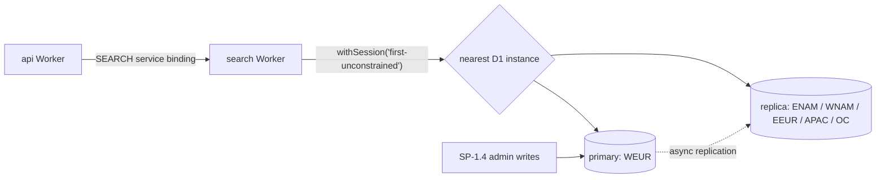

# search

Search platform Worker (epic [RedditPodcastPoster#1312](https://github.com/cultpodcasts/RedditPodcastPoster/issues/1312),
Gate G1). It owns the **dedicated search D1 databases** `cultpodcasts-search` and `cultpodcasts-search-preview` (SP-1.1,
[Api#219](https://github.com/cultpodcasts/Api/issues/219)) and will serve the D1 FTS5 engine
that replaces Azure AI Search, running side by side with Azure until cutover (G4).

Design docs: RedditPodcastPoster `docs/search-platform/` (start at `README.md`).

## Shape

| Worker | Config | D1 binding | Database |
|--------|--------|-----------|----------|
| `search` (production) | `wrangler.search.jsonc` top level | `SEARCH_DB` | `cultpodcasts-search` |
| `search-preview` | `wrangler.search.jsonc` `--env preview` | `SEARCH_DB` | `cultpodcasts-search-preview` |
| local | `--env local` | `SEARCH_DB` | Miniflare only |

- **Dedicated:** never the api Worker's `apiDB` (`cultpodcasts-api`), and the api Worker does
  not bind this database. It reaches this Worker over a **service binding** (SP-1.3), because
  zone Bot Fight Mode challenges server POSTs to public hostnames.
- **Service-binding only:** `workers_dev: false`, `preview_urls: false`, no routes.
- **Preview and production have separate databases** (Jon, 16 Nov 2026), so preview code and
  preview sync never touch the production index. The G2 sync path must therefore feed both.
- Region: primary in **WEUR** (near Azure Functions / Cosmos), read replicas everywhere else
  through the Sessions API (SP-1.2, below).
- Not part of Api Workers Builds (one Builds project = one Worker name).

## Schema

`migrations/0001_search_schema.sql`:

- `search_docs`: one row per playable (Episode, TvShowEpisode, Film, NewsReport), mirroring
  RPP `EpisodeSearchRecord`, plus **full descriptions**, **guests**, film
  **`alternative_titles`**, identity ids (`imdb_id`, `tmdb_id`, `tvdb_id`, series variants)
  and `modified_at` for the SP-1.4 stale-replay guard.
- `doc_subjects`: subject filter/facet rows (cascade on delete).
- `search_fts`: external-content FTS5, `tokenize='porter unicode61'`, kept in step by
  insert/update/delete triggers. Column order is a contract (SP-1.8 weights against it):
  `title, alternative_titles, series_name, subjects_text, description, guests,
  publisher_search_terms, episode_search_terms`. Changing it needs a shadow rebuild (SP-2.3).
- `search_meta`: `schema_version`. `GET /health` returns 503 until it matches
  `SEARCH_SCHEMA_VERSION` in `src/health.ts`.

### Write contract (FTS triggers)

`search_fts` is external-content: the triggers are the only thing keeping it in step with
`search_docs`.

- **Upsert only with `INSERT … ON CONFLICT(id) DO UPDATE SET …`.** It keeps the rowid and fires
  `search_docs_au`.
- **Never `INSERT OR REPLACE` / `REPLACE INTO` on `search_docs`.** REPLACE deletes the old row
  without firing `search_docs_ad` (unless `PRAGMA recursive_triggers` is on, which every write
  path would have to remember), so the old terms stay in `search_fts`: stale hits and a failing
  integrity check, with no error at write time.
- `search_docs_au` fires only when an FTS column changes (`AFTER UPDATE OF` the eight FTS
  columns), so updating `modified_at`, `image` or ids does not rewrite the index.
- After bulk work, check with the content-aware integrity check:
  `INSERT INTO search_fts(search_fts, rank) VALUES ('integrity-check', 1);`

`tests/search-worker.spec.ts` pins all of this.

### Migrations and schema version

- One migration per schema version: `0001_…` is version 1, `0002_…` is version 2, and so on.
- Every migration after `0001` ends with
  `UPDATE search_meta SET value = '<n>' WHERE key = 'schema_version';`
  and bumps `SEARCH_SCHEMA_VERSION` in `src/health.ts` in the same PR.
- The spec applies every file in `migrations/` in name order and checks the final
  `schema_version` equals `SEARCH_SCHEMA_VERSION`, so a migration that forgets either fails CI.

## Provisioning (Terraform, SP-1.10)

Both databases are provisioned by **Terraform**, not by hand: SP-1.10
([Api#270](https://github.com/cultpodcasts/Api/issues/270)) adds the `cloudflare` provider
with a `cloudflare_d1_database` for `cultpodcasts-search` and `cultpodcasts-search-preview`
(both primary in `weur`), and a CI workflow that runs `wrangler d1 migrations apply --remote`
for each database after `terraform apply` (preview first, then production), from
`workers/search/migrations`. Terraform created both databases on 16 Nov 2026; their ids are in
`wrangler.search.jsonc`, written by `infra/terraform/scripts/sync-wrangler-ids.mjs` from the
Terraform outputs. The local binding keeps its `local-cultpodcasts-search` id, which the sync
script never touches.

Deletion protection is part of SP-1.10: `prevent_destroy` on both databases, a CI plan guard
that fails on any destroy or replace, apply behind a GitHub environment approval, and D1 Time
Travel documented for point-in-time restore. Azure stays on bicep.

Never run `wrangler d1 create` / `d1 delete` for these by hand. Schema changes reach the remote
databases only through the Terraform workflow's migration step (after Jon approves the
`cloudflare-production` environment), not `wrangler d1 migrations apply --remote` from a laptop.

## Local

```sh
npm run search:migrate:local
npm run search:dev            # http://127.0.0.1:8789/health
```

## Routes

| Route | Purpose |
|-------|---------|
| `GET /health` | 200 when D1 answers and the schema version matches; 503 otherwise (retryable) |
| `POST /indexes/{index}/docs/search` | Azure AI Search docs/search over D1 FTS5 (SP-1.9) |

`GET /health` also returns `servedByRegion` / `servedByPrimary` (SP-1.2). The admin upsert/delete
route (SP-1.4) lands here in its own ticket.

## Read replication and the Sessions API (SP-1.2)

[Api#220](https://github.com/cultpodcasts/Api/issues/220). Both databases have
`read_replication = { mode = "auto" }` (Terraform module `infra/terraform/modules/search-stack`,
applied since SP-1.10), so Cloudflare keeps a read replica in each D1 region (ENAM, WNAM, WEUR,
EEUR, APAC, OC). D1 only routes a query to a replica when it runs through a **session**, so:

- **Every read goes through `readSession(env)`** (`src/d1-session.ts`):
  `env.SEARCH_DB.withSession("first-unconstrained")`, one session per request. The first query
  may go to the nearest replica; the rest of the request (the page/count/facet batch and then the
  page's subject lookup) sees a database at least as new as the first query (never older, as two
  independent reads on different replicas could). A test fails if any Worker source calls `SEARCH_DB.prepare` / `batch` directly.
- **No bookmarks from callers.** Search readers never write, and a result a few seconds behind the
  primary is fine for search (Azure indexing is not instant either).
- **Writes stay on the primary.** D1 always sends writes to the primary; the SP-1.4 admin route
  should use plain `env.SEARCH_DB` (or a `first-primary` session), not `readSession`.
- **`GET /health` uses the same path**, so it reports the schema version search actually sees: right
  after a migration a replica can briefly answer with the old version (503). It returns
  `servedByRegion` / `servedByPrimary` in its body and does not write the log line below.



### `served_by_region` log (soak)

Each successful `docs/search` request logs one line, `search: d1 read`, from the D1 result `meta`:

| Field | Meaning |
|-------|---------|
| `route` | `docs/search` |
| `environment` | `production` / `preview` / `local` |
| `servedByRegion` | Distinct `served_by_region` values in query order (`"ENAM"`, or `"ENAM,WEUR"` if a request spanned two) |
| `servedByPrimary` | `true` only when every query ran on the primary |
| `servedByColo` | Distinct `served_by_colo` values |
| `sqlDurationMs` | Sum of `timings.sql_duration_ms` (execution only, no network) |
| `queries` | D1 results read |

Fields D1 does not return (local Miniflare) are `null`. Failed requests log only the existing
`search: D1 failure` line. Query in Workers Observability with `message = "search: d1 read"`,
grouped by `servedByRegion`; the SP-3.2 soak dashboard charts it. The line is unsampled; if volume
ever matters, set `observability.head_sampling_rate` in `wrangler.search.jsonc`. Whether to keep it
after cutover is for SP-3.2 to decide.

## Query engine (SP-1.9)

Moved from the `search-demo/` prototype ([Api#269](https://github.com/cultpodcasts/Api/issues/269)),
read-only, against the SP-1.1 schema:

| File | Role |
|------|------|
| `src/query.ts` | Azure "simple" syntax → FTS5 `MATCH`, mirroring `en.lucene` (stopwords, hyphen split, possessives). Every atom is quoted, so user text cannot inject FTS5 syntax. |
| `src/odata.ts` | The OData subset the website sends: `eq` / `ne` / `null`, `search.in`, `subjects/any`, `and` / `or` / parentheses; facet specs. `lang` NULL means English. |
| `src/azure-response.ts` | The live Azure document (25 retrievable keys, Azure order) and envelope (`@odata.context: null`). |
| `src/docs-search.ts` | The route: body parsing, SQL, facets, `select`, errors. |

Contract (same as `search-demo`): `search`, `searchMode` (`any` default, `all`), `filter`,
`orderby` (`release desc` / `release asc`; relevance when searching, newest first when browsing),
`top` (default 50, max 1000) / `skip` / `count`, `facets` (`subjects`, `contentKind`, `lang`,
`seriesName`; `count:n` up to 1000) and `select`. The `{index}` segment and `api-version` are
accepted and ignored (one database per Worker), and so is `api-key`: the Worker is reachable only
over a service binding.

- **Indexed, not returned:** full descriptions are indexed uncapped and returned in full. `guests`
  and the hidden curator terms are searchable but, as in Azure, never returned.
- **Errors:** a bad body, filter or facet is **400** `{ error: { code: "", message } }` like Azure;
  a D1 failure, overload or missing schema is **503** with the fixed body
  `{ error: { code: "ServiceUnavailable", message: "Search is temporarily unavailable." } }`,
  which is retryable and never a 400. The D1 detail goes only to Workers logs
  (`console.error("search: D1 failure", …)`, 500 characters), because the api Worker forwards
  upstream error bodies to the browser.
- **Limits (400 past them):** `top` / `skip` are non-negative integers (`top` clamps to 1000;
  `skip` at most 100,000, as in Azure); `search` at most 8 KB, 256 terms and 32 operator changes;
  `filter` at most 32 KB and 32 levels of parentheses; body at most 256 KB.
- **D1's 100 bound parameters per statement:** lists (`search.in`, the page's subject lookup)
  bind as one JSON parameter through `json_each(?)`; a filter with more than 98 separate
  comparisons is a 400. The test adapter (`tests/support/searchD1.ts`) enforces the limit.
- **FTS5 nesting:** the translator keeps runs of one operator flat and parenthesises only operator
  changes, so long queries stay well inside the FTS5 parser's ~96-level stack.
- **Not yet:** bm25 column weights and title/AKA phrase-first ranking (SP-1.8), the `id`
  tie-break (SP-1.7).

Tests: `tests/search-query-engine.spec.ts` (translator, OData, response shape, and the route over
the migrated schema in `node:sqlite`); `tests/search-d1-session.spec.ts` (Sessions API read path,
`served_by_region` log, read replication on in Terraform).

### Running the parity harness locally

The `search-demo/harness` cases (on the prototype branch, [Api#214](https://github.com/cultpodcasts/Api/pull/214))
post Azure-shaped bodies to `/indexes/d1/docs/search`, which this route accepts unchanged:

```sh
npm run search:migrate:local   # local Miniflare D1 only
npm run search:dev             # http://127.0.0.1:8789
SEARCH_DEMO_URL=http://127.0.0.1:8789 SEARCH_API_KEY=unused node search-demo/harness/run.mjs
```

The harness still needs the other env names its README lists: production Azure (read-only) for
the comparison side, and a D1 token for its difference explanations. The local database starts
empty: load documents with the admin route once SP-1.4 lands.
